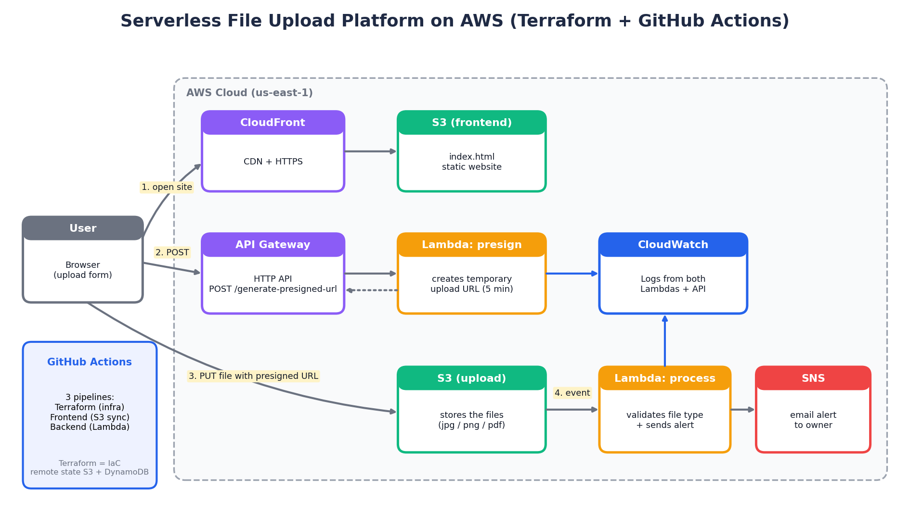
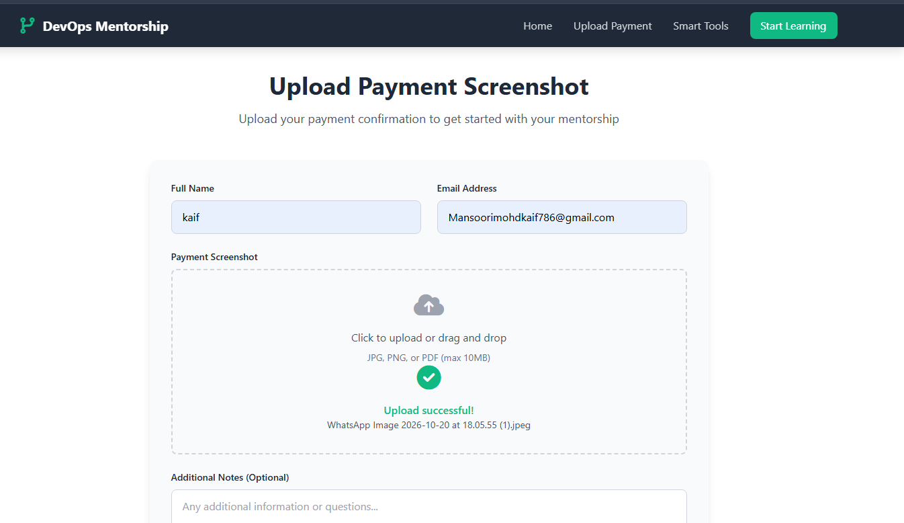
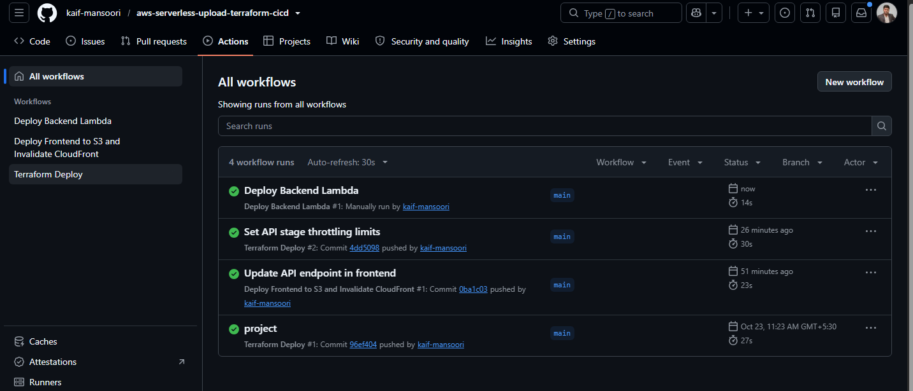
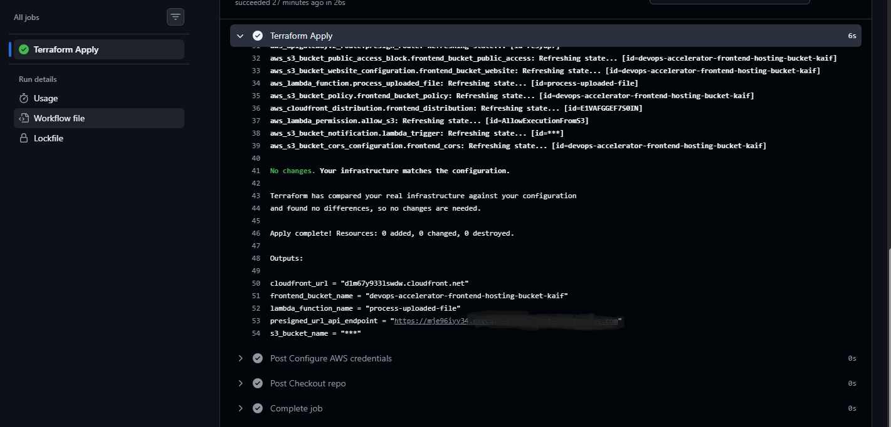
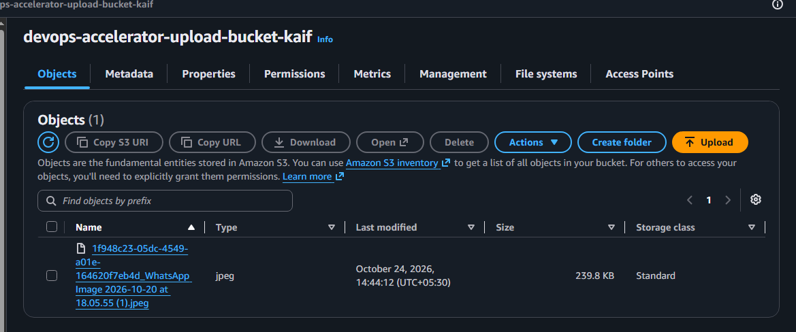
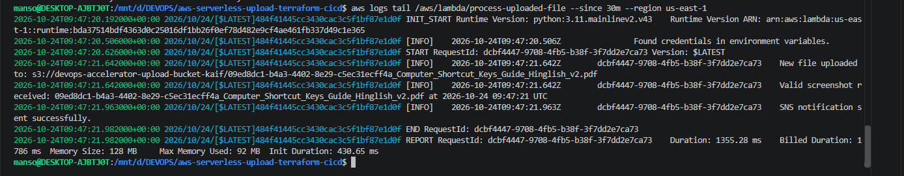
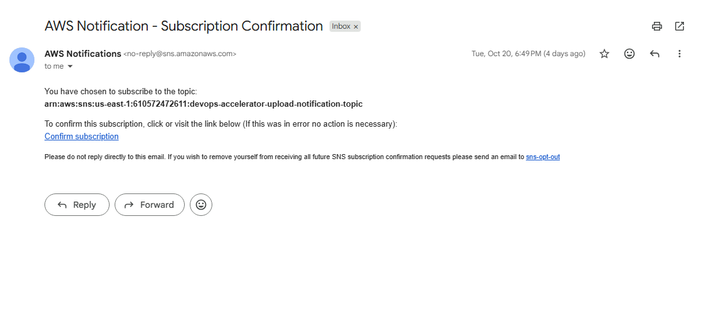
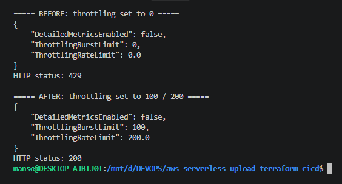
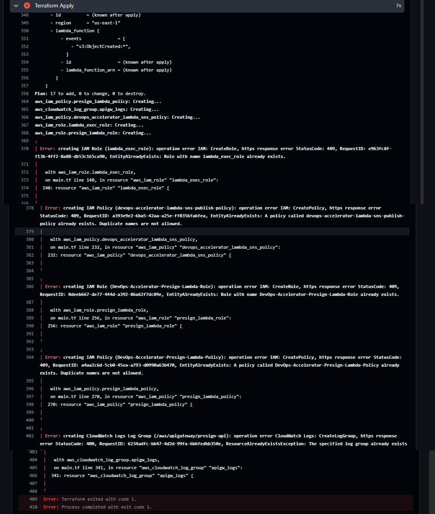

# Serverless File Upload Platform on AWS (Terraform + GitHub Actions CI/CD)

A serverless web app where a user uploads a file (JPG, PNG or PDF) from a CloudFront-hosted page. The file goes straight to S3 through a presigned URL, a Lambda function validates it, and the owner gets an email alert through SNS. All infrastructure is created with Terraform and deployed through GitHub Actions.



## What it does

1. The user opens the website (S3 + CloudFront) and fills in the form.
2. The page calls API Gateway, which invokes a Lambda function that returns a temporary presigned URL (valid 5 minutes).
3. The browser uploads the file directly to the S3 upload bucket with that URL.
4. The S3 `ObjectCreated` event triggers a second Lambda that checks the file type and logs the result to CloudWatch.
5. The Lambda publishes a message to SNS and the owner receives an email.

## Tech stack

| Layer | Tools |
|---|---|
| Frontend hosting | HTML/CSS/JS, S3 static website, CloudFront |
| API | API Gateway (HTTP API) |
| Compute | AWS Lambda (Python 3.12, boto3) |
| Storage | S3 |
| Notifications | SNS (email) |
| Monitoring | CloudWatch Logs |
| Infrastructure as Code | Terraform (remote state in S3, locking in DynamoDB) |
| CI/CD | GitHub Actions (3 pipelines) |
| Security | IAM roles, presigned URLs, CORS rules, GitHub Secrets |

## Repository structure

```
.
├── .github/workflows/      # terraform.yml, frontend.yml, backend.yml
├── backend/
│   ├── generate-presigned-url/main.py
│   └── process-uploaded-file/main.py
├── frontend/index.html
├── infra/terraform/        # main.tf, variables.tf, outputs.tf, terraform.tfvars
└── docs/images/            # screenshots
```

## CI/CD pipelines

| Pipeline | Trigger | What it does |
|---|---|---|
| Terraform Deploy | change in `infra/**` | init, validate, plan, apply |
| Deploy Frontend | change in `frontend/**` | `aws s3 sync` + CloudFront invalidation |
| Deploy Backend | change in `backend/**` | zips and updates both Lambda functions |

## Screenshots

| | |
|---|---|
|  |  |
| Upload page after a successful upload | All pipelines passing |
|  |  |
| Terraform apply finished | S3 buckets and the uploaded file |
|  |  |
| Lambda processing logs in CloudWatch | SNS email notification |
|  |  |
| API returned 429, then 200 after the fix | A Terraform error I had to debug |

## Problems I faced and how I fixed them

| # | What I saw | Root cause | How I fixed it |
|---|---|---|---|
| 1 | `terraform init` and bucket errors | The template had its author's bucket names, state bucket and email hard-coded | Used my own globally unique bucket names, my own state bucket and lock table, and my own email |
| 2 | Terraform `Missing key/value separator` | A block was placed inside `jsonencode()` instead of inside the API stage resource | Moved the block to the right place and ran `terraform validate` |
| 3 | Frontend and backend workflows failed | They ran before the infrastructure existed (Terraform had failed first) | Fixed Terraform first, then added the missing GitHub secrets |
| 4 | `Failed to fetch` in the browser | API Gateway returned HTTP 429 because the stage throttling limit was 0 | Tested the API with `curl`, read the stage settings, set burst 100 and rate 200, then added the same to Terraform |
| 5 | `File upload failed` | The upload bucket had no CORS rule for the browser PUT | Added a CORS configuration to the upload bucket |
| 6 | `EntityAlreadyExists` on `terraform apply` (IAM roles, policies, log group) | I had deleted my old state, so Terraform did not know the old resources still existed | Deleted the leftover roles, policies and log group, then ran the pipeline again |
| 7 | `404 NoSuchKey: index.html` on the CloudFront URL | The infrastructure was ready but the frontend pipeline had not uploaded the page yet | Put the new API URL in `index.html`, added the secrets, pushed, and the frontend pipeline deployed it |

How I debug: test the API with `curl` first and read the status code, then check the Lambda logs in CloudWatch. The browser message alone often hides the real cause.

Lesson: run `terraform destroy` while the state still exists. Deleting the state first leaves orphaned resources behind.

## How to deploy (short version)

1. Create the Terraform state bucket and DynamoDB lock table manually.
2. Put your own bucket names and email in `infra/terraform/terraform.tfvars`.
3. Add GitHub secrets: `AWS_ACCESS_KEY_ID`, `AWS_SECRET_ACCESS_KEY`, `FRONTEND_BUCKET_NAME`, `CLOUDFRONT_DIST_ID`.
4. Push to `main`. The Terraform workflow creates the infrastructure.
5. Put the API endpoint from the Terraform output into `frontend/index.html`, push again, and confirm the SNS subscription email.

Run `terraform destroy` when you are done to avoid AWS charges.

## What I learned

- Writing infrastructure as code with Terraform and managing remote state with locking.
- Building CI/CD pipelines with GitHub Actions and keeping credentials in secrets.
- The presigned URL pattern for secure direct-to-S3 uploads.
- Event-driven design with S3 events, Lambda and SNS.
- Debugging layer by layer: browser, API Gateway, Lambda, S3, CloudWatch.

## Possible improvements

- GitHub OIDC instead of long-lived access keys.
- Private S3 frontend bucket with CloudFront Origin Access Control.
- Authentication on the upload API, WAF or rate limiting, and a file size limit.
- Store name, email and notes in DynamoDB. CloudWatch alarms on Lambda errors.
- Split Terraform into modules.

## Credits

This project is based on a DevOps capstone template by my instructor, Nikunj (original repository: https://github.com/nikunj-java/Devops-Feb2026-capstone). The frontend page and the Lambda function code come from that template. I deployed it in my own AWS account, configured the Terraform infrastructure and GitHub Actions pipelines, and debugged the issues listed above.

> Edit this section so it matches exactly what you did yourself. Do not claim more than that.